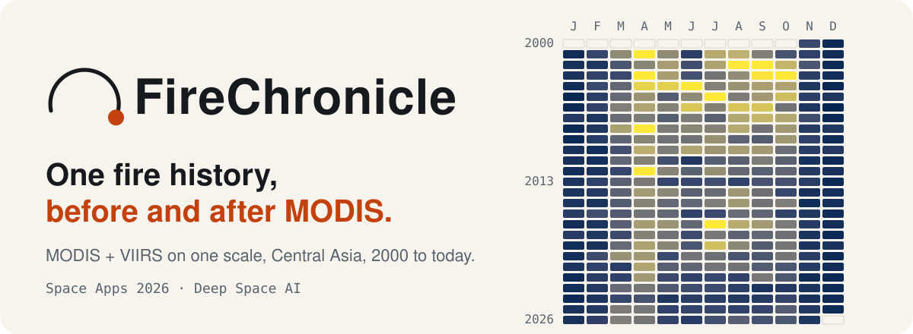
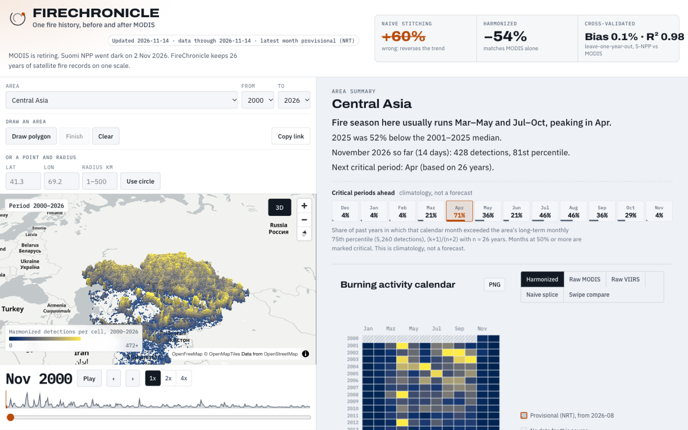
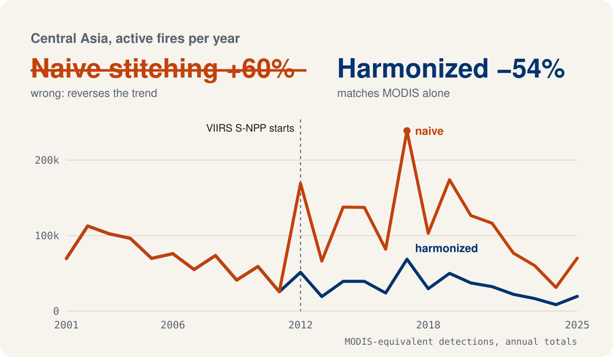
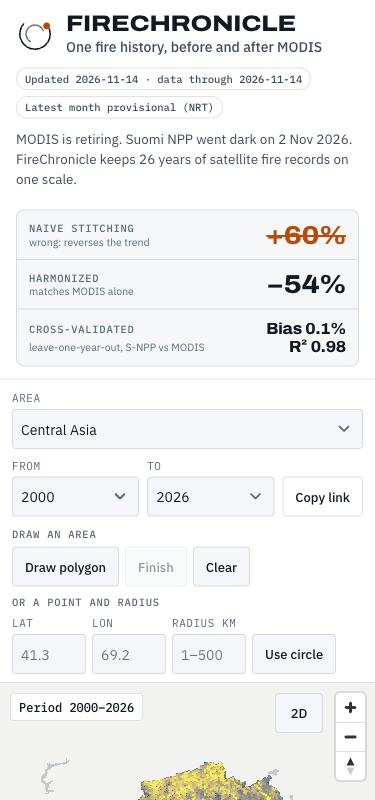
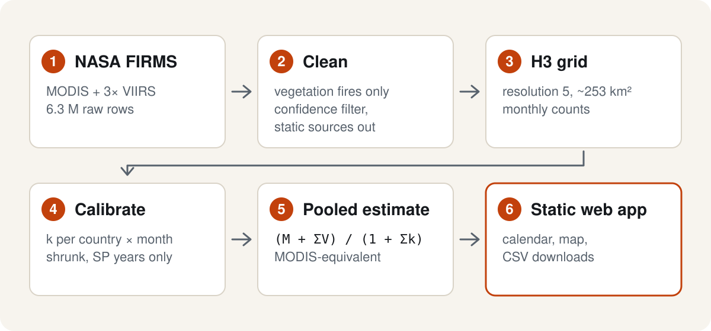

<p align="center">
  <picture>
    <source media="(prefers-color-scheme: dark)" srcset="./assets/readme/hero-dark.svg">
    <source media="(prefers-color-scheme: light)" srcset="./assets/readme/hero-light.svg">
    
  </picture>
</p>

<p align="center">
  <a href="https://komilovsg.github.io/firechronicle/"></a>
  
  
  
  <a href="LICENSE"></a>
</p>

**One consistent satellite fire record for Central Asia, 2000 to today.** MODIS (Terra, Aqua) and VIIRS (Suomi NPP, NOAA-20, NOAA-21) are put on one scale and shown as a burning-activity calendar for any area you pick.

<p align="center">
  <a href="https://komilovsg.github.io/firechronicle/"><b>Open the live app</b></a> ·
  <a href="#how-it-works">Method</a> ·
  <a href="#data-and-credits">Data</a>
</p>

<p align="center">
  <picture>
    <source media="(prefers-color-scheme: dark)" srcset="./assets/readme/desktop-dark.png">
    <source media="(prefers-color-scheme: light)" srcset="./assets/readme/desktop-light.png">
    
  </picture>
</p>

## The problem

- MODIS has recorded fires since 2000, but Terra and Aqua shut down in 2026-2027.
- VIIRS continues the record at 375 m and sees 2-15x more detections on the same fires. Suomi NPP, the first VIIRS satellite, stopped delivering data on 2 November 2026.
- Stitching the sensors naively **reverses the trend**: Central Asia appears to rise 60 % after 2012. MODIS alone, and the harmonized record, show it fell 54 %.

<p align="center">
  <picture>
    <source media="(prefers-color-scheme: dark)" srcset="./assets/readme/proof-dark.svg">
    <source media="(prefers-color-scheme: light)" srcset="./assets/readme/proof-light.svg">
    
  </picture>
</p>

## What you can do

| | |
|---|---|
| **Pick an area**: country, drawn polygon, or point plus radius | **Burning activity calendar**, year × month, 2000-2026, on an accessible colour ramp: harmonized, raw MODIS, raw VIIRS, naive splice, swipe comparison |
| **This month vs history**: median and P10-P90 range of all past years | **Critical periods ahead**: climatological probability of an above-normal month, next 12 months |
| **3D map** with a time-lapse of 26 years | **Downloads**: hotspots CSV, monthly series CSV, chart PNGs, a briefing card PNG |

Also: typical season, robust anomalies, the before/after proof with validation numbers, and a "why harmonize" pixel explainer.

<p align="center"></p>

## How it works

<p align="center">
  <picture>
    <source media="(prefers-color-scheme: dark)" srcset="./assets/readme/how-dark.svg">
    <source media="(prefers-color-scheme: light)" srcset="./assets/readme/how-light.svg">
    
  </picture>
</p>

- **Data:** NASA FIRMS standard-processing (SP) archives, with near-real-time (NRT) data for the latest months.
- **Cleaning:** vegetation fires only (`type = 0`); MODIS confidence ≥ 30, VIIRS nominal or high; persistent static sources (gas flares, industry) removed with an H3 resolution-8 mask learned from SP `type`.
- **Grid:** H3 resolution 5 (~253 km²), monthly counts per sensor.
- **Calibration:** each VIIRS satellite overlaps MODIS directly. Per stratum (country × calendar month), k = ΣVIIRS / ΣMODIS, the Poisson MLE, shrunk toward the global ratio for sparse strata and fitted on SP years only. Global k: S-NPP 3.45, NOAA-20 3.51, NOAA-21 3.64; strata range from 2.2 to 15. Before Aqua, Terra counts are scaled by a fitted Terra→Terra+Aqua factor (2.06).
- **Harmonized value:** the pooled minimum-variance estimate in MODIS-equivalent units, weighted by each sensor's coverage that month. MODIS-only before 2012, VIIRS-only once MODIS ends.

  `(M + Σ V) / (1 + Σ k)`

- **Uncertainty:** bootstrap over calibration years (200 draws) plus Poisson counting noise, an approximate 90 % band.

## Validation

| Check | Result |
|---|---|
| Leave-one-year-out: predict monthly MODIS from S-NPP alone (country × month, 2012-2025) | bias −0.13 %, R² 0.985 |
| Same for NOAA-20 (2018-2025) | bias +0.16 %, R² 0.972 |
| Same for NOAA-21 (2023-2025) | bias +1.33 %, R² 0.986 |
| NOAA-20 ratio: direct vs via S-NPP | 3.51 vs 3.41 |
| Pettitt change point, naive splice | 2012-03, at the sensor switch |
| Pettitt change point, harmonized and MODIS-only | 2011-01, a real decline that matches MODIS |

## Limitations

- A hotspot count is not burned area and not fire size.
- Clouds and smoke hide fires.
- NRT months are provisional.
- Terra and Aqua orbits are drifting.
- Suomi NPP ended on 2 Nov 2026.

## Run it yourself

```
pipeline/   Python: fetch_firms.py (download), core.py (math + tests), build.py (harmonize, write web data)
web/        Static web app: Vite + TypeScript, MapLibre GL, h3-js, ECharts, vitest
DATA_CONTRACT.md   format of web/public/data/*
```

Run the app:

```bash
cd web && npm ci && npm run dev      # npm test, npm run build
```

Reproduce the data:

```bash
cd pipeline && uv venv .venv --python 3.12 && uv pip install --python .venv/bin/python -r pyproject.toml && cd ..
echo "FIRMS_MAP_KEY=<your key>" > .env        # free key: https://firms.modaps.eosdis.nasa.gov/api/map_key/
pipeline/.venv/bin/python pipeline/fetch_firms.py country
pipeline/.venv/bin/python pipeline/fetch_firms.py api
pipeline/.venv/bin/python pipeline/build.py   # writes web/public/data/
pipeline/.venv/bin/python -m pytest pipeline
```

`npm run sample` overwrites `web/public/data/` with synthetic data. Use it only for UI work without the real data. The README images are generated from the real data by `python3 assets/readme/src/build_assets.py`.

## Data and credits

- NASA FIRMS: https://www.earthdata.nasa.gov/data/tools/firms
- MODIS C6.1 active fire, MCD14ML: doi:10.5067/FIRMS/MODIS/MCD14ML
- VIIRS 375 m active fire products:
  - S-NPP VNP14IMG: doi:10.5067/VIIRS/VNP14IMG.002
  - NOAA-20 VJ114IMG: doi:10.5067/VIIRS/VJ114IMG.002
  - NOAA-21 VJ214IMG: doi:10.5067/VIIRS/VJ214IMG.002
- User guides: Giglio et al., MODIS C6/C6.1 Active Fire Product User's Guide; Schroeder, VIIRS C2 375 m Active Fire User's Guide
- Boundaries: Natural Earth (public domain). Basemap: © OpenStreetMap contributors, OpenFreeMap.

We acknowledge the use of data and/or imagery from NASA's Fire Information for Resource Management System (FIRMS) (https://www.earthdata.nasa.gov/data/tools/firms), part of NASA's Earth Science Data and Information System (ESDIS).

FireChronicle is not an official NASA product and is not endorsed by NASA.

## Use of SI

**Use of SI:** parts of this project's code and text were written with SI (AI) coding assistance, and every part was reviewed and tested by the team.

## Team

**Deep Space AI**, Dushanbe, Tajikistan. Built for the NASA Space Apps Challenge 2026, challenge *Harmonization of MODIS and VIIRS Hot Spots*.

[@komilovsg](https://github.com/komilovsg) · [@fronzox](https://github.com/fronzox) · [@ilyoscisco2020](https://github.com/ilyoscisco2020)

## License

MIT. See [LICENSE](LICENSE).
